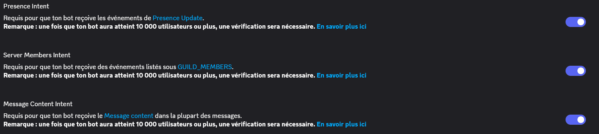
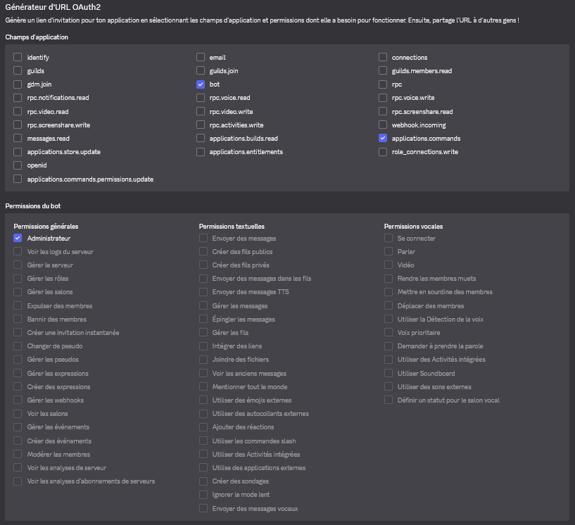

# Bot en cours de développement !

Version instable, problèmes potentiels et imprévisibilités sur certaines fonctionnalités.
- Veuillez attendre la sortie d'une **version stable** avant d'utiliser la source. Aucune date de sortie n'est estimée.
> Vous pouvez néanmoins utiliser cette source en y intégrant vos modifications.

# Fonctionnalités disponibles

### Pour tous les utilisateurs :

``?help``, ``?info`` & ``@Saxe Gambetta Bot``
> Permet de visualiser toutes les commandes et informations concernant le bot Saxe Gambetta.

``?info (@ utilisateur)``
> Permet de visualiser toutes les informations concernant un utilisateur.

### Pour les administrateurs :

``/create``
> Permet de créer un message embarqué personnalisé.

``?clear (0-100)``
> Permet la suppression d'un nombre défini de messages.

``?ban (@ utilisateur)``
> Permet le banissement définitif d'un utilisateur du serveur.

``?unban (ID utilisateur)``
> Permet le débanissement d'un utilisateur du serveur.

``?set-boost (on/off) (ID salon)``
> Permet de remercier les utilisateurs qui boostent le serveur.

``?set-welcome (on/off) (ID salon)``
> Permet de définir les messages de bienvenue pour les nouveaux membres.

``?set-autorole (ID role)``
> Permet de définir un rôle par défaut pour les nouveaux membres.

``?set-antilink (on/off)``
> Permet de filtrer les liens parmis ceux autorisés sur le serveur.

``?antilink-exception (https://exemple.com/)``
> Permet de créer une exception pour autoriser certains liens sur le serveur.

``?set-antispam``
> Permet d'établir un anti-spam.

``?set-antispam (nombre max. messages) (intervalle max. secondes)``
> Permet d'établir un anti-spam personnalisé.

### Autres :

- Status dynamique

# Lancer le projet (~5 minutes) :

1) Installez Visual Studio Code
2) Installez Node.js
3) Ouvrez le dossier extrait de son archive contenant le projet dans Visual Studio Code
4) Entrez le Token de votre BOT dans ``config/essential.json``
5) Ouvrez un nouveau terminal
6) Exécutez la commande ``npm install discord.js`` dans ce dernier
7) Exécutez la commande ``node index.js``

# Requis via Discord Developer Portal

